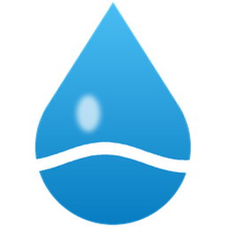

# WaterH for Home Assistant



[](https://hacs.xyz/)
[](https://github.com/raymanvh/ha-waterh/actions/workflows/validate.yml)

Unofficial Home Assistant integration for [WaterH](https://www.waterh.com) smart water bottles. It tracks how much you drink, your daily goal and the bottle's battery, and lets you log drinks from Home Assistant.

There are **three ways** to get your drinks into Home Assistant. Pick one when you add the integration:

| | **Bluetooth through Home Assistant** (recommended) | **WaterH Sync Android app** | **WaterH account** (official app) |
| --- | --- | --- | --- |
| **How drinks get in** | Home Assistant connects to the bottle itself | An app on your Android phone reads the bottle and sends drinks to Home Assistant | The official WaterH app uploads drinks to WaterH; Home Assistant reads them from your account |
| **Install on your phone** | Nothing | WaterH Sync (an APK from GitHub, not the Play Store) | The official WaterH app |
| **iPhone** | ✅ | ❌ Android only | ✅ |
| **WaterH account** | Not needed | Not needed | Needed (email and password) |
| **Extra hardware** | A Bluetooth adapter or ESPHome Bluetooth proxy near where the bottle usually is | None | None |
| **When drinks show up** | Within a few minutes while the bottle is near Home Assistant. Drinks taken away from home arrive when you get back. | Within a minute or two, wherever you are (if Home Assistant is reachable remotely) | Only after you **open** the official app |
| **Battery and charging sensors** | ✅ | ✅ | Only if you also run WaterH Sync |
| **Bottle display matches Home Assistant** | ✅ (clock, goal, today's total) | ✅ | Follows your WaterH account |
| **Use the official WaterH app too?** | ❌ No, see below | ❌ No, see below | ✅ It's required |
| **Where drinks are stored** | Home Assistant only | Home Assistant only | WaterH's servers |

**Which one?**

- **Most people: Bluetooth through Home Assistant.** Nothing to install, no account, works with any phone. All you need is Bluetooth coverage where the bottle usually sits, from a Bluetooth adapter on Home Assistant or an [ESPHome Bluetooth proxy](https://esphome.io/components/bluetooth_proxy.html).
- **Android users who want drinks to show up while away from home:** the WaterH Sync app. You can turn on Bluetooth through Home Assistant on the same entry as well, so the bottle syncs at home even when the phone is elsewhere.
- **If you want to keep using the official WaterH app** (or anything else connected to your WaterH account): WaterH account.

> [!IMPORTANT]
> **Bluetooth and the WaterH Sync app replace the official WaterH app. Don't use them together with it.** The bottle stores each drink only until something reads it. Whichever app syncs first takes the drinks off the bottle. If the official app gets there first, those drinks go to WaterH and never reach Home Assistant.

> **Not affiliated with WaterH.** Bluetooth mode uses the bottle's Bluetooth protocol, worked out from the official Android app. The account mode uses WaterH's private app API. Either could break if WaterH changes their bottle firmware or app. See [docs/API.md](docs/API.md) and the [protocol notes](https://github.com/raymanvh/waterh-sync-android/blob/main/docs/PROTOCOL.md).

## How each mode works

### Bluetooth through Home Assistant

Home Assistant connects to the bottle the same way the official app does, through any Bluetooth adapter or ESPHome Bluetooth proxy that can hear it.

1. Home Assistant listens for the bottle's Bluetooth broadcasts. The **Bottle in range** sensor shows whether it can hear it.
2. While the bottle is in range, Home Assistant connects every **sync interval** (5 minutes by default). Logging a drink or changing the goal in Home Assistant also syncs right away.
3. Each sync reads the drinks stored on the bottle, **saves them in Home Assistant first, and only then clears them from the bottle**. If anything fails partway through, nothing is cleared, and the drinks are read again on the next sync.
4. It then sets the bottle's clock, daily goal and today's total to match Home Assistant, so the bottle's own display agrees with your dashboards. You can turn this off.
5. Battery, charging and firmware are read on every sync.

**Away from home**, the bottle keeps drinks, with the time you drank them, until it's back in range. Nothing is lost; the drinks just arrive later and are placed at their real times.

**What you need**

- Home Assistant's **Bluetooth** integration working, with a Bluetooth adapter or an **ESPHome Bluetooth proxy with active connections enabled** (`bluetooth_proxy:` with `active: true`) within range of where the bottle usually is. Bluetooth range is roughly a room or two.
- The bottle not connected to a phone at the moment of a sync. A bottle accepts only one connection at a time.

### WaterH Sync Android app

The [WaterH Sync](https://github.com/raymanvh/waterh-sync-android) app runs in the background on your Android phone. Whenever the bottle wakes up nearby, the app reads its drinks over Bluetooth and posts them to this integration's private webhook URL. It clears them from the bottle only after Home Assistant confirms they're saved. Like Bluetooth mode, it also keeps the bottle's clock, goal and today's total in step with Home Assistant.

With your external or Nabu Casa remote URL in the app, drinks arrive from anywhere your phone has internet. With a local-only URL, they wait until you're home.

### WaterH account (official app)

Home Assistant signs in to your WaterH account and reads your log every few minutes. This is the same data the official app shows.

> [!NOTE]
> The bottle hands drinks over only when the **official app is open** on your phone. The official app doesn't sync in the background. Until you open it, new drinks don't reach WaterH or Home Assistant. If that's a problem, use Bluetooth through Home Assistant instead.

Optional: run the WaterH Sync app alongside the official app in its WaterH-account mode. It uploads drinks to WaterH in the background and adds battery and charging sensors (see [its README](https://github.com/raymanvh/waterh-sync-android)).

## Using Bluetooth and the Android app together

Entries without a WaterH account (Bluetooth or Android app) can use **both**: under **Configure**, pick the Bluetooth bottle *and* turn on **Accept drinks from the WaterH Sync Android app**. Home Assistant syncs the bottle at home and your phone syncs it while you're out. Each drink gets the same ID whichever way it arrives, so a drink seen by both is only counted once. If both try to connect at the same moment, one waits for the next interval.

## Things to know before you choose

Some of these are limits of the bottle itself; others simply haven't been tested yet. Bluetooth through Home Assistant is new in 0.4.0. It uses the same protocol the WaterH Sync app has used on a real bottle, and it has been tested with one WaterH Boost (946 mL) through ESPHome Bluetooth proxies. Wider use may turn up things one setup didn't.

- **Only one thing should read the bottle.** The official WaterH app, WaterH Sync, and Home Assistant each take the drinks off the bottle when they sync. Pick one mode, or Bluetooth plus WaterH Sync on the same entry, which share one drink store.
- **One connection at a time.** If your phone is connected to the bottle when Home Assistant tries, the sync fails and is retried next interval. The **Bluetooth sync** sensor shows why.
- **Proxy connection slots.** Each ESPHome proxy can hold only a few connections at once (often 3). A sync takes about 10–20 seconds, so this rarely matters, but busy proxies can delay a sync.
- **The bottle only broadcasts while awake.** It sleeps when left alone and wakes when moved. A sleeping bottle can't be synced, but it also hasn't had anything drunk from it.
- **Storage limit unknown.** How many drinks the bottle can hold between syncs isn't known. A day or two away is fine; weeks without any sync might not be.
- **Bottle battery.** Every sync wakes the bottle's radio briefly. 5 minutes is a balance between quick updates and battery; 1 minute works but uses more. The exact effect hasn't been measured.
- **Drink times come from the bottle's clock**, which Home Assistant sets on each sync. If you turn off **Keep the bottle in step with Home Assistant**, the clock is no longer corrected and drink times can drift.
- **Time zone.** The bottle's clock is local time, and Home Assistant uses its own time zone. When using the Android app as well, keep your phone and Home Assistant in the same time zone, or the same drink could be stored twice an hour apart.
- **Tested bottle:** WaterH Boost (946 mL). Other models that use the same protocol should work, but haven't been tested. The Vita uses a different status format and isn't supported for Bluetooth or WaterH Sync yet.
- **Drinks stay in Home Assistant.** Without a WaterH account nothing goes to WaterH, so the official app, and anything connected to your WaterH account, won't see them. Home Assistant keeps 30 days of individual drinks; long-term history is in Home Assistant's statistics (see [Charting when you drank](#charting-when-you-drank)).
- **Bottle drinks are recorded as water.** The bottle doesn't know what's in it. Use **Log drink** or the `waterh.log_drink` action for coffee, tea or juice.
- **Switching between the WaterH account and the no-account modes** means adding a new entry. Drinks don't carry over between them. Switching between Bluetooth and the Android app (or using both) is just a setting on the same entry.

## What you get

Every mode gets these:

| Entity | Description |
| --- | --- |
| **Water today** | Hydration since local midnight (bottle + manual), in your chosen unit. Attributes: `drinks`, `bottle_ml`, `manual_ml`, `liquid_total_ml`. |
| **Goal progress** | Water today ÷ daily goal, in %. |
| **Drinks today** | Number of drinks today. |
| **Last drink** | Size of the most recent drink. Attributes: `drink_id`, `source` (`manual` or the bottle model), `water_type`, `liquid_amount_ml`, `temperature`. |
| **Last drink time** | When the most recent drink was taken. |
| **Recent drinks** | How many drinks are listed in its `drinks` attribute: each drink with the time it was taken (`time`, `amount` in your unit, `ml`, `type`, `source`). Covers the last 7 days by default (setting below); account mode lists today's. The list isn't saved to the database. See [Charting when you drank](#charting-when-you-drank). |
| **Last water temperature** | Water temperature reported by the bottle (°C, disabled by default). |
| **Last update** (diagnostic) | Account mode: when Home Assistant last checked WaterH. Without an account: when the bottle was last read (by Home Assistant or the app). |
| **Daily goal** | Your daily goal. Account mode: changes it in the WaterH app. Without an account: kept in Home Assistant and written to the bottle on the next sync. |
| **Drink amount** / **Drink type** | What **Log drink** adds (default 8 fl. oz. / 250 mL of water). |
| **Log drink** | Adds a manual drink, like the **+** button in the WaterH app. |
| **Volume unit** (configuration) | Automatic, mL or fl. oz. (account mode also offers "Same as the WaterH app"). |

Read from the bottle over Bluetooth (by Home Assistant or WaterH Sync). These appear after the bottle's first successful read:

| Entity | Description |
| --- | --- |
| **Bottle battery** | Battery level, in %. |
| **Bottle charging** | On while the bottle is on its charger. |
| **Bottle firmware** (diagnostic) | The bottle's firmware version. |
| **Last bottle read** (diagnostic) | When the bottle was last read. |

Bluetooth through Home Assistant only:

| Entity | Description |
| --- | --- |
| **Bottle in range** (diagnostic) | On while a Bluetooth adapter or proxy can hear the bottle. |
| **Bluetooth sync** (diagnostic) | `Waiting for bottle`, `Syncing`, `OK`, `Not in range` or `Failed`. Attributes: `last_error` (why the last sync failed), `last_attempt`, `next_sync_after`, `via` (which adapter or proxy), `drinks_last_sync`, `cleared_last_sync`, and `steps` (what the last sync did, for troubleshooting). |
| **Last Bluetooth sync** (diagnostic) | When the last successful sync finished. |
| **Sync bottle now** | Syncs immediately, ignoring the interval. Shows an error if it can't. |
| **Drink reminder** (configuration) | When the bottle's light ring reminds you to drink: **Off**, **Periodic** (every interval) or **Smart** (after an interval without drinking). See [Drink reminders](#drink-reminders). |
| **Drink reminder interval** (configuration) | 15, 30, 45, 60, 90 or 120 minutes, the values the bottle accepts. |
| **Drink reminders start / end** (configuration) | The hours reminders are active, e.g. 09:00 to 22:00. The end can be after midnight. |
| **Reminder light effect** (configuration) | How the light ring looks when it reminds you: Breathe or Calm in your colour, or a theme with its own colours (Rainbow pulse, Warmth, Christmas). See [Reminder light](#reminder-light). |
| **Reminder light colour** (configuration) | Red, Yellow, Green, Cyan, Blue, Purple or White, for **Breathe** and **Calm** (unavailable while a theme is selected). |
| **Flash light ring (experimental)** (configuration) | Flashes the ring blue now, e.g. to find the bottle. Doesn't show or change your reminder light. See [Experimental](#experimental). |
| **Recalibrate bottle** (configuration) | Recalibrates the empty bottle in one press. **Configure → Recalibrate the bottle** walks you through it instead. See [Recalibrating the bottle](#recalibrating-the-bottle). |

"Water today" uses WaterH's hydration value. For plain water it equals the volume; in account mode, other drink types may be weighted differently by WaterH, and the raw volume is in `liquid_total_ml`.

### Charting when you drank

Sensor history is recorded when Home Assistant *hears about* a drink, not when you took it. With Bluetooth through Home Assistant, the bottle only syncs when it's home, so a day out (or a week away) arrives in one go: a History graph of **Water today** shows it as one jump at sync time, and drinks from earlier days never show up in those days at all.

Every drink is stored with the time it was taken, so there are three ways to chart that instead. Use whichever suits you, or several:

| | Resolution | How far back | Card |
| --- | --- | --- | --- |
| **Intake statistic** | Hourly | Forever (Home Assistant's long-term statistics) | Built-in **Statistics graph** |
| **Recent drinks** sensor | Exact time of each drink | 1–30 days (setting) | [ApexCharts card](https://github.com/RomRider/apexcharts-card) (HACS) |
| **`waterh.get_drinks`** action | Exact | 30 days (account mode: your whole WaterH history) | Scripts, automations, templates |

#### Intake statistic (hourly, long-term)

The integration keeps an hourly long-term statistic built from the drinks' own times: **`waterh:water_intake_<entry id>`**, named *"&lt;entry title&gt; water intake"*. When drinks arrive late, the hours they were drunk are filled in and every later total moves up with them. It's in your display unit (switching units converts the stored history).

```yaml
type: statistics-graph
title: Water today
chart_type: line
period: hour
days_to_show: 1
stat_types:
  - state   # today's running total, starting over at midnight
entities:
  - waterh:water_intake_01abc...   # your statistic id: search "water intake" in the card editor
```

Use `stat_types: [change]` with `chart_type: bar` and `period: hour`, `day`, `week` or `month` for intake per hour, day, week or month.

- **Hourly**: Home Assistant's long-term statistics can't be finer, so a drink at 10:40 counts in the 10:00–11:00 hour.
- **Without an account**, the last 30 days are rebuilt from the stored drinks (on first install, that backfills them). **Account mode** sees today's drinks, so a drink that only reaches WaterH after midnight is missed for the day before.
- Needs Home Assistant's recorder (on by default).

#### Recent drinks sensor (exact times)

The **Recent drinks** sensor's `drinks` attribute lists every drink of the last few days with the time it was taken, oldest first:

```yaml
drinks:
  - id: bottle-1795724405-300
    time: "2026-11-26T14:20:05-06:00"
    amount: 10.1        # your display unit (see the unit attribute)
    ml: 300
    type: water
    source: bottle      # or manual
```

Built-in cards can't plot an attribute list, so use [ApexCharts card](https://github.com/RomRider/apexcharts-card) with a `data_generator`. Today's running total, stepping up at the exact time of each drink:

```yaml
type: custom:apexcharts-card
header:
  show: true
  title: Water today
graph_span: 24h
span:
  start: day
series:
  - entity: sensor.waterh_bottle_recent_drinks
    name: Water
    curve: stepline
    data_generator: |
      const from = new Date(start).getTime();
      const to = Math.min(new Date(end).getTime(), Date.now());
      let total = 0;
      const points = [[from, 0]];
      for (const d of entity.attributes.drinks) {
        const t = new Date(d.time).getTime();
        if (t < from || t > to) continue;
        total += d.amount;
        points.push([t, total]);
      }
      points.push([to, total]);
      return points;
```

Each drink of the last week as its own bar:

```yaml
type: custom:apexcharts-card
graph_span: 7d
series:
  - entity: sensor.waterh_bottle_recent_drinks
    name: Drinks
    type: column
    data_generator: |
      return entity.attributes.drinks.map((d) => [new Date(d.time).getTime(), d.amount]);
```

The list only covers the days set in **Days in the Recent drinks list**, and it's sent to your dashboards on every update, so keep it to the days you actually chart. It isn't written to the database.

#### `waterh.get_drinks` action

Returns drinks with their times for any range (see [Actions](#waterhget_drinks)), for scripts, automations, template sensors or sending elsewhere.

## Installation

### HACS (recommended)

[](https://my.home-assistant.io/redirect/hacs_repository/?owner=raymanvh&repository=ha-waterh&category=integration)

Click the button above, then **Download** and restart Home Assistant. Or add it by hand:

1. In HACS, open the menu (⋮) → **Custom repositories**.
2. Add `https://github.com/raymanvh/ha-waterh` with category **Integration**.
3. Search for **WaterH**, install it, and restart Home Assistant.

### Manual

Copy `custom_components/waterh` into your Home Assistant `config/custom_components/` folder and restart.

## Setup

**Settings → Devices & services → Add integration → WaterH**, then choose a mode. Each choice on that screen says what it needs and what you get.

If Home Assistant already hears your bottle, it may offer it under **Discovered**; adding it from there sets up Bluetooth through Home Assistant directly.

### Bluetooth through Home Assistant

1. Close the official WaterH app (and WaterH Sync) so nothing is connected to the bottle, and pick the bottle up to wake it.
2. Choose **Bluetooth through Home Assistant** and pick your bottle from the list. If it isn't listed, wake it and submit with the box empty to search again, or type its Bluetooth address.
3. Give it a name (e.g. *Bottle*, which gives `sensor.waterh_bottle_water_today`).
4. Set your **Daily goal** in Home Assistant. It's written to the bottle on the next sync.

From now on, stop opening the official WaterH app.

### WaterH Sync Android app

1. Choose **WaterH Sync Android app**, give it a name, and copy the webhook URL it shows.
2. Install [WaterH Sync](https://github.com/raymanvh/waterh-sync-android/releases), choose **Local only**, and paste the URL. Use your external or Nabu Casa URL if you want drinks to arrive while you're away.
3. Set your **Daily goal** in Home Assistant.

Keep the webhook URL private: anyone who has it can add drinks.

### WaterH account

1. Choose **WaterH account** and enter the email and password for your WaterH app account.
2. **Signed up with Google or Facebook?** Those accounts have no WaterH password. Use **Forgot password** in the WaterH app to set one, then use it here.
3. Your password is used once to get a login token and is **not stored**. If WaterH ever rejects the token, Home Assistant asks you to sign in again.

## Settings (Configure)

**Bluetooth and Android app entries** (**Settings → Devices & services → WaterH → Configure**; with Bluetooth on, choose **Sync settings**. The other choice is [Recalibrate the bottle](#recalibrating-the-bottle)):

| Setting | Default | What it does |
| --- | --- | --- |
| **Bluetooth bottle** | The bottle you picked (Bluetooth entries) / Off (app entries) | The bottle Home Assistant syncs over Bluetooth, or **Off**. |
| **Bluetooth sync interval** | 5 min | How often to sync while the bottle is in range (1–60 min). Shorter means fresher data and a little more bottle battery. |
| **Keep the bottle in step with Home Assistant** | On | Sets the bottle's clock, daily goal and today's total on each sync. Off = only read drinks (they're still cleared from the bottle once saved). |
| **Accept drinks from the WaterH Sync Android app** | Off (Bluetooth entries) / On (app entries) | Opens the webhook for WaterH Sync. The URL is shown on this screen. |
| **Volume unit** | Automatic | Automatic (Home Assistant's unit system), mL or fl. oz. |
| **Days in the Recent drinks list** | 7 | Days of individual drinks (today included, 1–30) on the **Recent drinks** sensor. More days means a bigger list sent to dashboards on each update; it isn't stored in the database. |

At least one of **Bluetooth bottle** and **Android app** has to be on.

**WaterH account entries:**

- **Volume unit**: Automatic, Same as the WaterH app, mL or fl. oz.
- **Update interval**: minutes between checks of your WaterH account (default 5). Drinks still only arrive once the official app has uploaded them.
- **OAuth client ID / secret (advanced)**: leave empty. Only needed if WaterH changes the values built into their app. See [docs/API.md](docs/API.md#if-waterh-changes-their-app-credentials).
- The webhook URL for the optional WaterH Sync battery sensors.

## Drink reminders

The bottle's light ring can remind you to drink. These settings live on the bottle itself, so they work without your phone or Home Assistant nearby. With Bluetooth through Home Assistant you can see and change them from Home Assistant instead of the official app.

| Setting | What it does |
| --- | --- |
| **Drink reminder** | **Off**; **Periodic**: lights up every interval during active hours; **Smart**: lights up only if you haven't drunk from the bottle for an interval. |
| **Drink reminder interval** | 15, 30, 45, 60, 90 or 120 minutes. These are the values the official app's bottle-light screen offers; the bottle ignores the whole reminder setting for any other interval. |
| **Drink reminders start / end** | When reminders are active each day. An end earlier than the start (e.g. 09:00 to 01:00) runs past midnight. |

How it works:

- Home Assistant reads the bottle's current reminder settings on every sync, so the entities show what the bottle actually has. They're unavailable until the bottle has synced once.
- When you change one, it's written to the bottle on the next sync. If the bottle is in range that's straight away; otherwise it's when the bottle is next in range. The entities' `waiting_for_bottle` attribute stays `true` until a sync reads the new setting back from the bottle.
- If the bottle doesn't take a setting (it still reports its old one after a retry), Home Assistant stops sending it, shows the bottle's own settings again, and says so in the **Bluetooth sync** sensor's `steps`.
- Once you've changed a reminder setting in Home Assistant, Home Assistant keeps the bottle at that setting, like the daily goal. If you never change them here, the bottle's own settings are left alone.
- They're normal entities, so automations can change them, for example Smart reminders on workdays and Off on weekends.

### Reminder light

You can also choose how the ring looks when it reminds you, the same choices as the official app:

| Setting | Options |
| --- | --- |
| **Reminder light effect** | **Breathe** or **Calm** in your colour, or a theme with its own colours: **Rainbow pulse**, **Warmth** or **Christmas**. |
| **Reminder light colour** | Red, Yellow, Green, Cyan, Blue, Purple, White, for **Breathe** and **Calm**. Unavailable while a theme is selected; your last colour comes back when you switch to Breathe or Calm. |

A new bottle's light is Breathe in blue. (The official app calls that "Default blue"; it isn't offered separately here because it looks the same as Breathe + Blue.)

How it works:

- **The bottle can't report its light setting**, so both start as *unknown* and show what Home Assistant last set. If you never set them here, the bottle keeps whatever it had.
- A change is sent on the next sync (straight away if the bottle is in range) and then not sent again. `waiting_for_bottle` is `true` until it's been sent. When it arrives, the ring lights up briefly in the new setting.
- If you set only one of the two, the other uses a new bottle's setting (Breathe, Blue).

**Only these seven colours.** The ring's red, green and blue are each simply on or off, so these seven are all it can show. (Tested on a Boost: sending pink `#FF69B4` showed white, and orange `#FF8000` showed yellow.)

## Experimental

Features with limited testing. They're safe to try (they only send commands the official app sends itself), but they've only been tried on one bottle. Feedback in an issue helps.

### Flash light ring

**Flash light ring (experimental)** sends the official app's "control light" command, which the app sends when you tap the bottle on its bottle-details screen. On a Boost it **flashes the ring blue**, whatever reminder light effect and colour you've chosen, so it's handy for finding the bottle or checking Home Assistant can reach it. It doesn't preview your reminder light, and it doesn't change it: the next reminder still uses your effect and colour.

If you've changed the [reminder light](#reminder-light) and that change hasn't reached the bottle yet, it's sent first. It doesn't read or clear drinks.

## Recalibrating the bottle

**What it does.** The bottle works out how much you drank from changes in what it measures. Recalibrating records what it reads when it's **empty**, as its new starting point. It's the same as **Recalibrate bottle** in the official WaterH app, so you don't need the official app for it. Stored drinks aren't touched. Available with Bluetooth through Home Assistant.

**When.** If drinks are logged noticeably too large or too small. Even calibrated, WaterH says the Boost can be up to 20% off.

**How (guided):** **Settings → Devices & services → WaterH → Configure → Recalibrate the bottle**. The screen explains each step and won't start until you've ticked every box:

1. **Empty the bottle.** Pour it out with the cap off, so the bottle doesn't log it as a drink.
2. **Twist the cap back on.**
3. **Stand it upright on a flat surface**, such as a table, and let go.
4. Make sure it's near a Bluetooth adapter or proxy and no phone is connected to it.

Submit, and leave the bottle alone for about 10 seconds. Its blue light flashes while it records its empty weight. The screen then says it's done, or shows what went wrong so you can try again.

**Or with the button:** the **Recalibrate bottle** button (configuration section of the device page) does the same in one press, for dashboards or scripts. It doesn't show the checklist, so get the bottle ready first. You get a "WaterH bottle recalibrated" notification when it's done, or an error.

Either way, the result is kept in the `last_recalibration` and `last_recalibration_result` attributes of **Bluetooth sync**. To check the result, drink a measured amount and compare it with what Home Assistant logs.

Recalibration is new in 0.4.0. The command and the bottle's replies come from the official app's code, and it has worked on a real Boost (946 mL).

## Actions

### `waterh.log_drink`

Adds a manual drink, like the **+** button in the WaterH app. Use it in automations and scripts (for example an NFC tag by the coffee maker); the **Log drink** button does the same thing.

| Field | Required | Description |
| --- | --- | --- |
| `amount` | yes | How much you drank. |
| `unit` | no | `ml` or `oz`. Defaults to the unit in the integration options. |
| `drink_type` | no | `water` (default), `coffee`, `tea` or `juice`. |
| `time` | no | When you drank it. Defaults to now. |
| `config_entry_id` | no | Only needed with more than one WaterH entry. |

```yaml
action: waterh.log_drink
data:
  amount: 8
  unit: oz
  drink_type: coffee
```

### `waterh.set_reminder_light`

Sets the reminder light (Bluetooth through Home Assistant), like the two **Reminder light** selects, e.g. from an automation. See [Reminder light](#reminder-light).

| Field | Required | Description |
| --- | --- | --- |
| `effect` | no | `breathe`, `calm`, or a theme: `rainbow_pulse`, `warmth`, `christmas`. |
| `color` | no | `red`, `yellow`, `green`, `cyan`, `blue`, `purple` or `white`. For `breathe` and `calm` only; with a theme it's an error. |
| `config_entry_id` | no | Only needed with more than one WaterH entry. |

### `waterh.delete_drink`

Removes a drink by ID. The most recent drink's ID is the `drink_id` attribute of **Last drink**, so this works as an "undo":

```yaml
action: waterh.delete_drink
data:
  drink_id: "{{ state_attr('sensor.waterh_bottle_last_drink', 'drink_id') }}"
```

### `waterh.get_drinks`

Returns individual drinks with the times they were taken. Without an account, Home Assistant keeps the last 30 days; in account mode, drinks before today are fetched from WaterH. Both fields are optional: `start` defaults to local midnight today, `end` (not included) to no end. Times without a time zone are Home Assistant's.

```yaml
action: waterh.get_drinks
data:
  start: "{{ today_at() - timedelta(days=1) }}"
  end: "{{ today_at() }}"
response_variable: yesterday
```

Response:

```yaml
start: "2026-11-25T00:00:00-06:00"
end: "2026-11-26T00:00:00-06:00"
unit: fl. oz.
total: 64.2
total_ml: 1899
drinks:
  - id: bottle-1795622705-120
    time: "2026-11-25T10:05:05-06:00"
    amount: 4.1
    ml: 120
    type: water
    source: bottle
  # ...
```

For example `{{ yesterday.total }}`, or `{{ yesterday.drinks | selectattr('source', 'eq', 'manual') | list | count }}` for how many drinks were logged by hand.

## Example automation

```yaml
automation:
  - alias: "Hydration reminder"
    triggers:
      - trigger: time_pattern
        hours: "/2"
    conditions:
      - condition: time
        after: "09:00:00"
        before: "21:00:00"
      - condition: numeric_state
        entity_id: sensor.waterh_bottle_goal_progress
        below: 50
    actions:
      - action: notify.notify
        data:
          message: >
            You're at {{ states('sensor.waterh_bottle_goal_progress') | int }}% of your water goal.
```

(Entity IDs depend on the name you gave the entry; check the device page.)

## Troubleshooting

**Bluetooth through Home Assistant**

- **Bottle not found during setup / Bottle in range stays off**: pick the bottle up to wake it. Make sure no phone is connected to it. Check that a Bluetooth adapter or proxy is within a room or two, and that proxies have active connections enabled. **Settings → Devices & services → Bluetooth** shows your adapters and proxies.
- **Bluetooth sync says Failed**: read its `last_error` attribute. Common causes: a phone connected to the bottle (close the official app or WaterH Sync), the bottle at the edge of range (a failed sync as you leave or arrive home is normal), all proxy connection slots busy, or the bottle going back to sleep mid-sync. It retries automatically next interval; **Sync bottle now** retries immediately.
- **Drinks missing**: check that the official WaterH app wasn't opened (it takes drinks off the bottle). The `steps` attribute of **Bluetooth sync** shows how many drinks the last sync read and cleared.
- **The bottle's display shows a different total**: it's updated on the next sync, unless **Keep the bottle in step with Home Assistant** is off.

**WaterH Sync Android app**

- See the [WaterH Sync README](https://github.com/raymanvh/waterh-sync-android). The app's log shows each sync and Home Assistant's reply.

**WaterH account**

- **"Wrong email or password"**: check that you can log in to the WaterH app with email and password (not just Google). See setup above.
- **Drinks are missing or late**: the official app hasn't uploaded them yet. Open it, then wait for the next update. **Last update** shows when Home Assistant last checked.
- **Everything stopped working with login errors**: WaterH may have changed their app credentials. See [docs/API.md](docs/API.md#if-waterh-changes-their-app-credentials).

**Reporting a problem**: download **diagnostics** from the integration page and attach it. Tokens, email, account ID, names, the bottle's address and the webhook ID are removed.

## How it was built

The WaterH API was mapped by recording the official Android app's traffic (HTTP Toolkit) and decompiling it (jadx). The same decompiled app documented the bottle's Bluetooth protocol, which the [WaterH Sync app](https://github.com/raymanvh/waterh-sync-android) implemented and tested on a real bottle first. Notes are in [docs/API.md](docs/API.md) and the app's [PROTOCOL.md](https://github.com/raymanvh/waterh-sync-android/blob/main/docs/PROTOCOL.md).

## Disclaimer

This project is not endorsed by or affiliated with WaterH Inc. "WaterH" is their trademark. The integration only reads your own data and your own bottle, but using an unofficial API or protocol may go against WaterH's terms of service. Use it at your own risk.

## License

MIT
